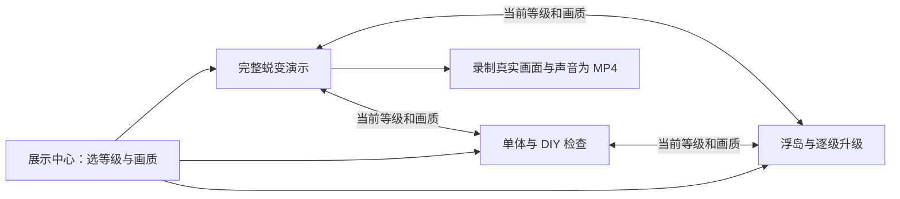

# 模型展示系统

## 入口与操作链路

统一入口为 `/tools/models.html`，只展示当前已发布模型，不依赖登录、后端接口或玩家关卡进度。



| 页面 | 用途 | 下一步 |
| --- | --- | --- |
| `models.html` | 选择六级店铺、看实装缩略图，不初始化 WebGL | 进入任一展示页，或返回游戏 |
| `building-evolution.html` | 当前级别静态预览；点击播放后从地摊连续升至地标 | 暂停/继续、静音、重播；切回当前模型检查 |
| `buildings-preview.html` | 单体旋转、正背面、底部、分件、模块 DIY | 将同级模型放回浮岛检查，或进入连续演示 |
| `island-buildings-preview.html` | 核对地表、人物比例、招牌和逐级升级 | 切回单体或连播，等级跟随成功加载/升级的结果 |

所有页面顶部共用导航，并提供画质选择和复制链接。修改等级会更新地址栏，切换页面保留当前等级与画质。浏览器前进/后退重新恢复可用场景；离开演示时取消加载、释放场景并停止声音。

## URL 约定

示例：`/tools/buildings-preview.html?level=4&quality=smooth`。

- `level`：0–5，分别为地摊、商车、精品店、工业旗舰店、未来商业街和百货地标。越界数值收敛到边界，非法值回到 0。
- `quality`：`auto`、`detail`、`smooth`。非法值回到 `auto`；自动档沿用游戏的设备判断，流畅档实际加载 lite GLB。
- 连续演示尊重 URL 的初始等级，方便预览和返回；按下「播放完整演示」后会重置为 0，完整播放五次升级。演示过程中链接更新为当前实际模型等级。
- `presentation=1`：仅录制工具使用，隐藏跨页导航以保留干净画面，不绕过加载或音效逻辑。
- URL 不保存自由视角、玩家进度或 DIY 配色。DIY 使用原有独立预览存储；演示声音不覆盖游戏音量偏好。

## 资源与生命周期

三个 WebGL 展示页复用 `assets/models/manifest.json`、正式的 web/lite GLB 和 `js/emc-model-loader.js`。模型版本进入资源 URL；贴图使用生产 CSP 允许的图片解码路径。展示系统不复制另一套店铺模型。

连续演示预热版本化 HTTP 资源，但只保留当前岛屿及正在切换的建筑。完整演示使用自己的全景镜头，正式游戏保留升级前聚焦镜头。五次升级共用一个画布与岛屿；暂停会冻结真正的升级动画，资源失败可重试，减少动态效果沿用游戏设置。

展示中心的六张透明 WebP 来自实际发布模型，共约 204 KiB。更新模型后可用 `tools/render-showcase-posters.cjs` 重渲染，不使用概念图冒充实装效果。

## 本地运行与录制

在仓库根目录运行静态服务：

```powershell
python -m http.server 5173 --bind 127.0.0.1
```

访问 `http://127.0.0.1:5173/tools/models.html`。前端无需构建。浏览器首次点击后才能播放声音。

录制与浏览器测试需要 Node.js、Playwright；导出 MP4、重渲染缩略图还需要 PATH 中的 FFmpeg/ffprobe。依赖可安装在仓库外：

```powershell
npm install --prefix "$env:TEMP/emc-browser" --no-save --package-lock=false playwright@1.56.1
$env:EMC_PLAYWRIGHT_MODULE = "$env:TEMP/emc-browser/node_modules/playwright"
node tools/record-building-evolution.cjs
```

Windows 默认使用已安装的 Edge；其他环境先安装 Playwright Chromium，再设置 `EMC_CHROMIUM` 为其可执行文件路径。

| 变量 | 用途 |
| --- | --- |
| `EMC_TEST_URL` | 静态服务地址，默认 `http://127.0.0.1:5173` |
| `EMC_PLAYWRIGHT_MODULE` | 可被 Node require 的 Playwright 模块位置 |
| `EMC_CHROMIUM` | 自定义 Chromium/Edge 可执行文件；优先于浏览器通道 |
| `EMC_BROWSER_CHANNEL` | 默认 `msedge`，适用于使用已安装浏览器的本地环境 |
| `EMC_VIDEO_OUTPUT` | 默认 `output/building-evolution/building-evolution.mp4` |
| `EMC_FFMPEG` / `EMC_FFPROBE` | 自定义媒体工具路径 |
| `EMC_SCREENSHOTS` | 浏览器测试截图输出目录，CI 自动上传 |

录制工具打开实际演示页，采集页面画面和 WebAudio 最终混音，再输出 H.264/AAC MP4。录制不使用生成式视频；视频、封面和原始捕获文件都是本机产物，不依赖生产数据库，也不随仓库部署。

重新生成实装缩略图：

```powershell
node tools/render-showcase-posters.cjs
```

## 发布与验收

生产按 [运维手册](operations.md) 的 tag 发布流程进行。本次需要同步更新 Apache 模板：旧配置默认拒绝 `/tools/`，只部署静态文件会导致展示页 403。从已审核的仓库版本运行 `deploy/scripts/install-host.sh` 更新配置，再发布 tag；脚本自带 Apache 配置检查及失败恢复。本 PR 不直接操作生产。

模板只放行四个展示 HTML 和对应 CSS/JS，包括 `building-diy`；录制脚本、资产生成脚本和其他工具页仍不对外发布。展示页资源设为 `no-cache`；大 GLB/图片沿用资源缓存，清单与模块图需一起发布。

上线后从 `/tools/models.html?level=3&quality=smooth` 开始检查：进入单体、换到 4 级、进入浮岛、进入完整演示，再切回单体；各步应保留等级与画质。确认 lite 模型、贴图、升级音效可用，播放按钮从 0 级开始完整连播。再检查复制链接、失败重试和手机导航。

自动化检查：

```powershell
node --test js/tests/emc-model-showcase.test.cjs
node js/tests/emc-model-showcase-browser.cjs
node js/tests/emc-building-evolution-browser.cjs
```

浏览器链路测试按生产 CSP 执行，核对无账号/关卡 API 请求；CI 额外跑完整连播，覆盖暂停/继续、重播、音效/静音、同一岛屿与画布、存储隔离和资源失败重试。真实生产访问状态仍需发布后按上述入口验收。

## 演进演示计时与 CI（issue #99）

演示停留和升级效果共用可暂停的单调播放时钟，按实际有效时间计算进度。旧版停留每帧最多累计 80ms，升级每帧最多累计 50ms，SwiftShader 的低帧率会不断丢弃时间，造成相同代码树偶发播放超时。现在暂停、后台隐藏和未播放时间不累计；恢复不追赶这些间隔。时钟从升级效果开始时记录基准，异步模型准备期间暂停也不会漏过冻结。

`ShopScene.upgradeTo` 可选传入 `animationTime`（返回毫秒的函数）；完整演示使用该时钟，普通游戏未传参时保留原有逐帧升级行为。该参数不改变升级次数、模型加载、渲染、音效、资源释放或取消语义。

浏览器回归使用 [Playwright Clock](https://playwright.dev/docs/clock)，在导航前安装并暂停测试时钟，避免 Playwright 1.56 在已运行的页面暂停时回拨 performance.now、使场景的上一帧时间停在未来。真实模型与 GPU 准备期间按小步推进回调。动画/停留按 1000ms 跳跃推进并刷新后续帧，兼容 Playwright 1.56 的快进回调处理；模型加载和 GPU 编译期间继续处理小步定时回调。保持 1440/390px 布局及真实模型，测试 DPR 设为 0.5，降低软件 WebGL 的填充成本。完整播放限制为最多 32 次稀疏跳时（模型/GPU 准备小步不占用该预算），防止停留计时重新按帧丢弃时间。第一段升级断言 400ms 应推进约 0.22，防止重新引入 50ms 截断；另验证长帧只切换/揭示一次、普通游戏保留原有帧上限、暂停和隐藏一分钟不推进、恢复、五次音效/静音、同岛同画布、重播和资源重试。失败保留当前进度与页面错误诊断，单段推进有 60 秒实际时间上限，不再依赖 180 秒真实时间等待整部演示。

运行现有 `js/tests/emc-building-evolution-browser.cjs` 即可，GitHub Actions 的 evolution 单项继续执行该脚本，无需新配置或依赖。
